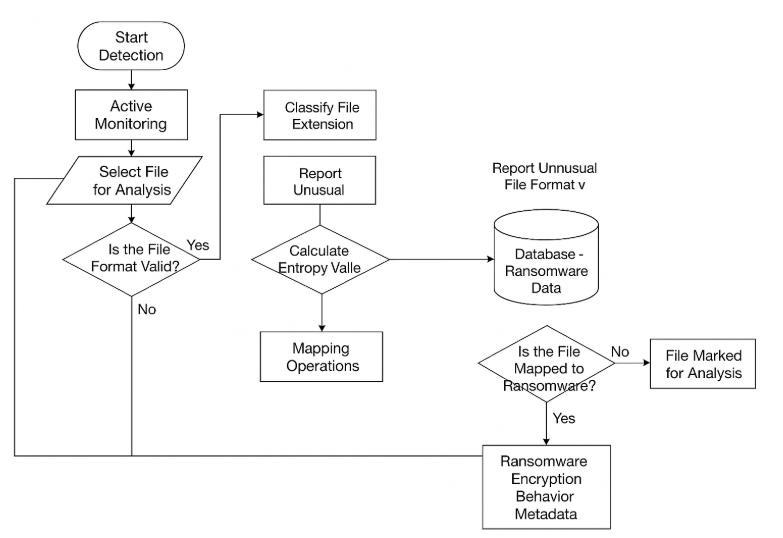
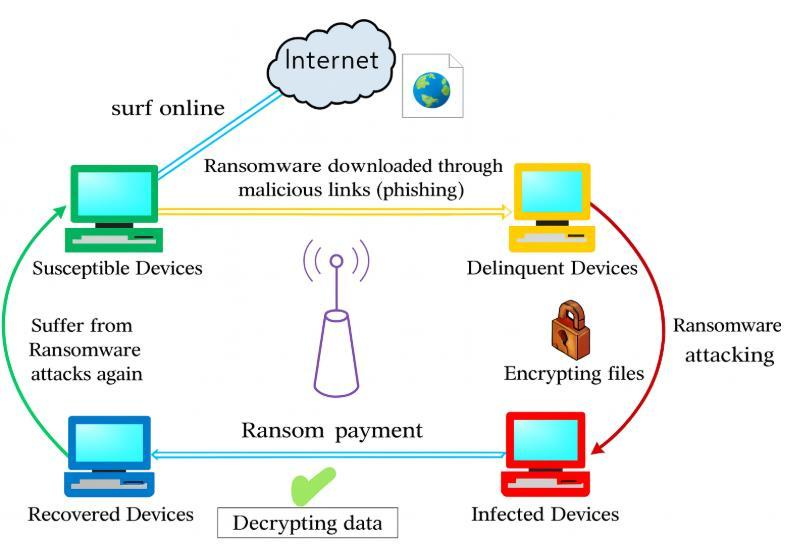

# Ransomware Behavior on Hosts

**Research project | Wright State University**

This group project looks at how ransomware affects files, system access, and recovery. We studied how encryption is used to lock users out of their data and why restoring files does not always mean a system is safe to use again.

**Authors:** Martin Inyang, Swathi Tathireddy, Shreya Gajjar, Ashma Bhandari, and Mass Shalash.

**Status:** Research report completed. Implementation code will be added later.

## What we studied

- How ransomware reaches a host and starts encrypting files.
- Changes to file content, extensions, and metadata.
- How attacks interfere with backups and system access.
- WannaCry and NotPetya as case studies.
- File entropy and other signs that may help identify suspicious activity.

## Main points

Ransomware can damage more than files. It can also remove recovery options and interrupt normal system use. The report discusses backups, patching, monitoring, and network separation as parts of a layered defense.

File entropy is one useful signal, but it is not enough to identify ransomware on its own. Compressed files and legitimate encrypted backups can also have high entropy.

## Figures from the report

### Detection workflow

This diagram shows the file checks discussed in the research. It is a design illustration; the detector has not been implemented in this repository.

### Attack lifecycle

This diagram shows the attack and recovery sequence used in the report. Recovery after payment is not guaranteed.

## Planned implementation

I plan to add a file-analysis tool, test it with harmless sample files, and compare entropy with other file-change indicators. Results and run instructions will be added with the code.

[Research notes](docs/RESEARCH.md) · [Report and figure sources](docs/SOURCES.md)
